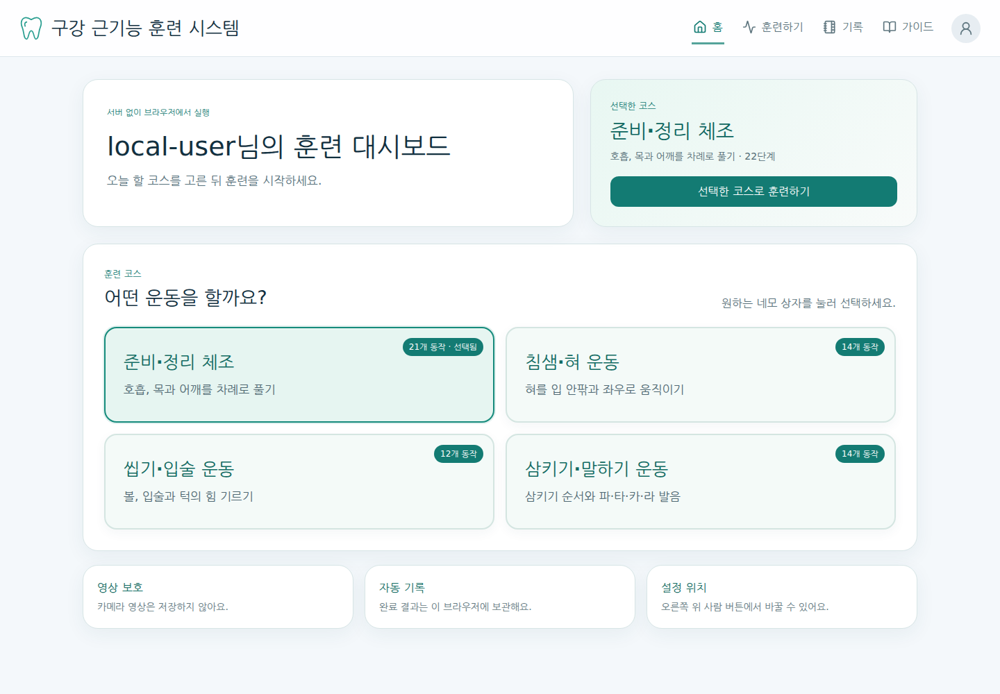
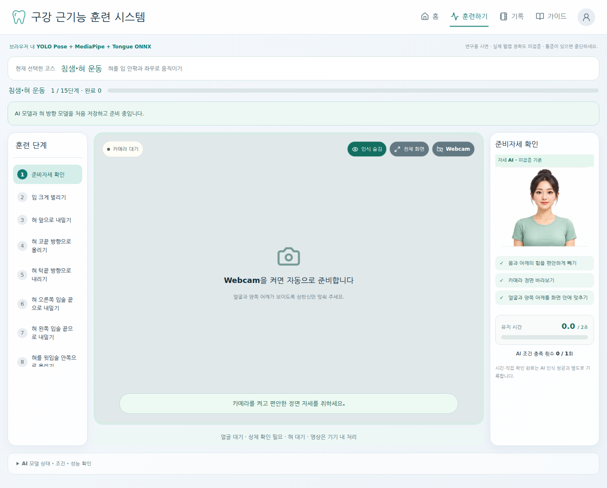
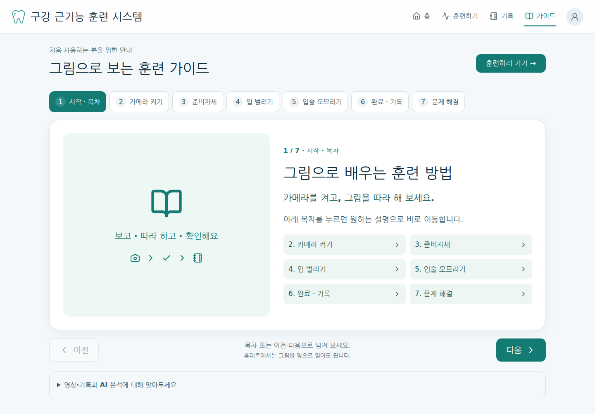
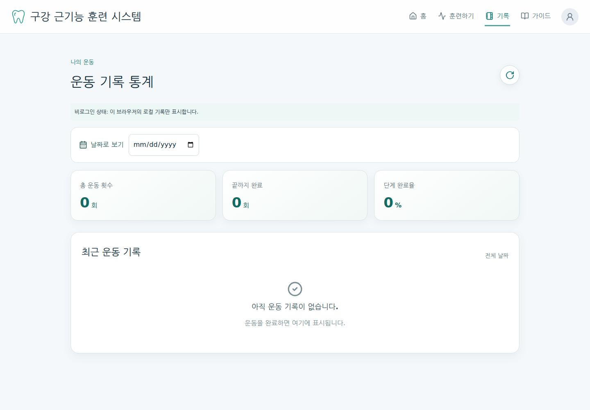

# AI Oral Training — 구강 근기능 훈련 시스템

**웹캠으로 목·어깨·입술·혀 동작을 안내하고, 브라우저 AI 분석과 훈련 기록으로 꾸준한 구강 운동을 돕는 연구용 웹 애플리케이션입니다.**

기본 앱은 Python 분석 서버 없이 브라우저에서 실행됩니다. 사용자는 코스를 선택하고 동작 그림을 따라 운동하며, 시스템은 자동 판정이 가능한 동작과 직접 확인이 필요한 동작을 구분해 안내합니다.

> 연구·학습용 시연 프로젝트입니다. 의료기기나 진단 도구가 아니며, 동작 임계값과 치료 효과는 임상 검증되지 않았습니다. 운동 중 통증이나 불편함이 생기면 중단하세요.

## 1. 프로젝트 소개

### 어떤 프로젝트인가요?

카메라에서 얻은 자세·얼굴 특징을 이용해 사용자가 훈련 순서를 따라갈 수 있도록 돕는 웹 서비스입니다. 하나의 화면에서 카메라, 단계 목록, 동작 안내 그림, 유지 시간과 반복 횟수를 확인할 수 있습니다.

### 주요 기능

- **4개 훈련 코스**: 준비·정리 체조, 침샘·혀 운동, 씹기·입술 운동, 삼키기·말하기 운동
- **자세와 얼굴 분석**: YOLO11n-pose와 MediaPipe Face Landmarker를 이용한 상반신·입 모양 확인
- **혀 방향 표시**: MobileNetV3-Small ONNX 모델의 예측 방향·신뢰도·안정 상태 표시
- **단계별 진행 관리**: 중립 자세 측정, 유지 시간, 반복 횟수, 건너뛰기와 직접 완료 확인
- **사용자 설정**: 참여자 코드, 거울 화면, 특징점 표시, 마이크 및 움직임 임계값 조절
- **훈련 기록**: IndexedDB 로컬 저장, 세션·단계 결과 조회
- **WIZ 연동 환경의 기록 동기화**: 로그인한 계정의 결과를 WIZ API에 전송하고 실패 시 재시도
- **기기 내 영상 처리**: Web Worker에서 추론하며 기본 브라우저 실행 경로에서 영상 프레임을 서버로 전송하거나 저장하지 않음
- **모델 준비 최적화**: 백그라운드 사전 준비, 공용 Worker 재사용, 버전별 모델 자산 캐시

### 코스 구성

실제 코스 정의는 [`frontend/src/browser/courses.ts`](frontend/src/browser/courses.ts)에 있습니다.

| ID | 코스 | 주요 동작 | 진행 방식 |
|---|---|---|---|
| A | 준비·정리 체조 | 정면 자세, 호흡, 목 돌리기·기울이기, 어깨 올리기, 상체 좌우 기울이기 | 자세·얼굴 AI 및 직접 확인 |
| B | 침샘·혀 운동 | 입 벌리기, 혀 앞·위·아래·좌우 움직이기, 입 안쪽·잇몸·볼 운동 | 입 벌리기는 얼굴 AI, 혀 운동은 직접 확인. 외부 혀 방향은 모델 예측 표시 |
| C | 씹기·입술 운동 | 볼 부풀리기·오므리기, 아·이·에·우·오 입 모양, 턱 저항 운동 | 얼굴 AI, 시간 안내 및 직접 확인 |
| D | 삼키기·말하기 운동 | 호흡·침 삼키기, 혀 움직임, 파·타·카·라·파타카라 연습 | 직접 확인, 시간 안내 및 선택형 음성 텍스트 확인 |

## 2. 사용한 기술

아래 버전은 현재 프로젝트의 의존성 파일에 선언된 값입니다.

### 프론트엔드와 화면

| 기술 | 버전·형식 | 사용 목적 |
|---|---|---|
| TypeScript | 5.8.3 | 화면, 추론 통신, 판정 엔진과 기록 데이터의 타입 정의 |
| React / React DOM | 19.1.0 | 대시보드·훈련·기록·가이드 화면 구성 |
| Vite | 6.4.5 | 개발 서버와 프로덕션 빌드 |
| React Router DOM | 7.18.4 | HashRouter 기반 화면 이동 |
| Tailwind CSS / CSS | 4.1.5 / CSS | 화면 레이아웃, 상태·진행률 표시와 반응형 스타일 |
| Lucide React | 0.503.0 | 카메라·메뉴·설정 아이콘 |
| Recharts | 3.10.1 | 의존성에 포함된 차트 라이브러리. 현재 기록 화면은 HTML 통계·진행률 표시를 사용 |
| Canvas / ImageBitmap | 브라우저 API | 카메라 프레임 전달과 특징점 오버레이 |

### AI와 브라우저 처리

| 기술 | 역할 |
|---|---|
| YOLO11n-pose → ONNX | 사람·어깨 등 COCO 17개 자세 키포인트 분석. 브라우저 모델 입력은 320×320 |
| MediaPipe Tasks Vision 1.2.0 | Face Landmarker로 얼굴 478개 랜드마크와 표정 계수 추출 |
| MobileNetV3-Small → ONNX | 입 주변 224×224 RGB 크롭에서 7개 입·혀 상태 분류 |
| ONNX Runtime Web 1.22.0 | WebAssembly 기반 ONNX 모델 실행 |
| Web Worker / OffscreenCanvas | UI 스레드와 영상 추론 분리 |
| Cache Storage | 모델 자산의 버전별 로컬 캐시 |
| IndexedDB | 훈련 세션과 단계 결과를 브라우저에 저장 |
| Web Speech API | 선택형 한국어 음성 텍스트 인식. 지원 여부는 브라우저에 따라 다름 |

### 선택형 백엔드와 개발 도구

| 기술 | 버전·역할 |
|---|---|
| Python | 별도 FastAPI 분석 서버, 모델 변환·게시 스크립트 |
| FastAPI / Uvicorn | 0.115.12 / 0.34.2, 이전 서버 분석 방식 재현용 API·WebSocket |
| SQLAlchemy / SQLite | 2.0.40 / 관계형 훈련 기록 저장 |
| OpenCV / NumPy | 4.11.0.86 / 1.26.4, 서버 영상 처리 |
| Ultralytics / MediaPipe | 8.3.127 / 0.10.21, Python 모델 실행 |
| Vitest / pytest | 5.0.5 / 8.3.5, 프론트엔드·백엔드 자동 테스트 |
| Git / GitHub | 소스 버전 관리 및 공유 |
| WIZ | 기존 서비스 안에 빌드 자산을 게시하고 로그인 기록 API와 연동 |

프론트엔드 의존성은 [`frontend/package.json`](frontend/package.json), Python 의존성은 [`backend/requirements.txt`](backend/requirements.txt)를 참고하세요.

## 3. 실행 화면

아래 이미지는 **2026-11-15에 로컬 프로덕션 미리보기 서버를 실행하고 Chromium으로 직접 캡처한 화면**입니다. 개인정보와 실제 훈련 기록이 없는 상태입니다. 훈련 화면은 카메라를 켜기 전의 대기 화면이며, 실사용자 웹캠 인식 성공을 증명하는 자료는 아닙니다.

### 홈 — 코스 선택

4개 코스 중 오늘 진행할 운동을 선택하고 훈련 화면으로 이동합니다.



### 훈련하기 — 단계와 카메라 안내

왼쪽에서 전체 단계를 확인하고, 가운데 카메라 영역과 오른쪽 동작 그림·완료 조건을 함께 봅니다.



### 가이드 — 사용 순서와 운동 설명

카메라 준비와 운동 방법을 확인합니다. 안내 그림은 운동 동작 설명용이며 인식 결과가 아닙니다.



### 기록 — 저장한 훈련 결과 조회

훈련 세션과 단계별 결과를 확인합니다. 아래는 기록이 없는 초기 화면입니다.



## 4. 실행 방법

### 4.1 준비 사항

- Git, Node.js 20 이상 권장, npm
- 웹캠이 있는 PC 또는 노트북
- WebAssembly SIMD, Web Worker, OffscreenCanvas, WebGL을 지원하는 최신 Chrome·Edge 권장
- 카메라 사용을 위한 `localhost` 또는 HTTPS 환경
- 기본 브라우저 앱은 Python, 별도 DB 설치, 외부 AI API 키 없이 실행 가능

### 4.2 저장소 내려받기

```bash
git clone https://github.com/xericen/AI-Oral-Training.git
cd AI-Oral-Training
```

### 4.3 프론트엔드 개발 실행

```bash
cd frontend
npm ci
npm run dev
```

터미널에 표시된 주소를 엽니다. 기본 주소는 `http://127.0.0.1:5173`이며, 포트가 사용 중이면 다른 주소가 표시될 수 있습니다.

`predev` 스크립트가 Worker와 ONNX·MediaPipe 런타임 파일을 준비합니다. 모델은 `frontend/public/models/`에 포함되어 있으며, 첫 방문에는 다운로드와 모델 초기화에 시간이 필요합니다. 캐시가 남아 있어도 브라우저를 새로 열면 실행 세션 초기화는 필요합니다.

### 4.4 실제 사용 순서

1. **홈에서 코스 선택**: A~D 중 원하는 코스를 누르고 `선택한 코스로 훈련하기`를 선택합니다.
2. **사람 설정 확인**: 오른쪽 위 사람 메뉴에서 참여자 코드·거울 화면·특징점·마이크 옵션을 조절합니다. 참여자 코드는 로그인 계정이 아닙니다.
3. **카메라 켜기**: 훈련 화면에서 `Webcam` 버튼을 누르고 브라우저의 카메라 권한을 허용합니다.
4. **중립 자세 준비**: 얼굴과 양쪽 어깨가 화면 안에 들어오게 앉아 편안한 정면 자세를 유지합니다.
5. **단계별 운동**: 오른쪽 그림과 설명을 따라 움직입니다. AI 단계는 조건을 유지하고, 직접 확인 단계는 동작 후 `직접 1회 완료 확인` 버튼을 누릅니다.
6. **다음 단계 진행**: 완료된 단계는 자동으로 다음 단계로 이동합니다. 혀 방향 예측 표시 자체는 단계 완료 조건이 아닙니다.
7. **기록 확인**: 마지막 단계가 완료되면 결과가 저장되고 기록 화면으로 이동합니다.

기록은 같은 사이트·같은 브라우저에 저장됩니다. 브라우저 데이터 삭제나 다른 기기 사용 시 로컬 기록을 그대로 볼 수 없습니다.

### 4.5 프로덕션 빌드와 로컬 미리보기

```bash
# frontend 디렉토리에서 실행
npm run build
npm run preview
```

빌드 결과는 `frontend/dist/`에 생성됩니다. 미리보기 기본 주소는 `http://127.0.0.1:4173`입니다. 정적 호스팅에는 `dist/`의 전체 내용을 업로드하며, 카메라 사용을 위해 HTTPS를 제공해야 합니다. HashRouter를 사용하므로 화면 경로는 `/#/training`, `/#/records` 형태입니다.

GitHub에 소스를 push하는 것과 웹사이트를 배포하는 것은 별도 작업입니다. 이 저장소의 실행 명령만으로 GitHub Pages 등이 자동 배포되지는 않습니다.

### 4.6 선택형 Python 백엔드 실행

현재 기본 React 앱은 이 FastAPI 서버를 호출하지 않습니다. 초기 서버 분석 방식을 재현하거나 비교할 때만 사용합니다. 아래 명령은 Linux·macOS 기준이며, 기존 검증 환경은 Python 3.11입니다.

```bash
# 저장소 루트에서 실행
cd backend
python3 -m venv .venv
source .venv/bin/activate
pip install -r requirements.txt
python scripts/download_models.py
uvicorn app.main:app --host 127.0.0.1 --port 8000
```

Windows PowerShell에서는 가상환경을 `.venv\Scripts\Activate.ps1`로 활성화합니다. API 문서는 `http://127.0.0.1:8000/docs`에서 볼 수 있습니다. 서버 시작 시 `backend/training.sqlite3`에 필요한 테이블을 생성하며, `ORAL_DATABASE_URL`로 SQLAlchemy 연결 문자열을 변경할 수 있습니다.

빈 SQLite DB를 스키마로 생성하려면 SQLite CLI가 설치된 환경에서 다음 명령을 실행합니다.

```bash
# 저장소 루트에서 실행
sqlite3 backend/training.sqlite3 < database/schema.sql
```

실제 사용자 DB, Python 가상환경, 원본 Python 모델 가중치와 코어 덤프는 Git에 포함하지 않습니다. 자세한 내용은 [DB 저장 구조](database/README.md)와 [레거시 서버 문서](docs/legacy-server.md)를 참고하세요.

## 5. 만든 이유와 목표

### 만든 이유

구강 운동은 여러 동작을 정해진 순서로 반복해야 하므로, 설명만 읽으면서 운동하면 현재 단계·유지 시간·반복 횟수를 함께 확인하기 어렵습니다. 이 프로젝트는 **동작 안내와 진행 확인, 결과 기록을 한 화면에서 제공하는 방법**을 구현하기 위해 만들었습니다.

별도 분석 서버 설정이 필요하면 실행 과정이 복잡해지므로, 기본 경로를 브라우저 AI 추론으로 구성했습니다. 카메라 영상을 기기 내에서 처리하고 결과만 보관하는 구조로, 설치 부담과 영상 전송을 줄이는 방향을 목표로 삼았습니다.

### 프로젝트 목표

| 목표 | 구현한 내용 | 추가로 확인할 점 |
|---|---|---|
| 따라 하기 쉬운 운동 안내 | 4개 코스, 단계별 그림·설명, 진행률·반복 횟수 표시 | 실제 사용자 대상 사용성 평가 |
| 브라우저 중심 실행 | React 앱과 Worker 기반 기기 내 추론 | 기기·운영체제·브라우저별 속도와 안정성 |
| 판정의 범위 구분 | 자세·얼굴 AI, 시간 안내, 직접 확인, 음성 텍스트를 구분 | 각 동작별 오탐·미탐과 임계값 평가 |
| 훈련 지속성 지원 | 세션·단계 결과 로컬 저장, WIZ 환경의 계정 동기화 | 장기간 사용성과 실제 훈련 지속률 |
| 혀 모델의 점진적 적용 | 방향 예측과 안정 상태 표시 | 다양한 참가자·조명·좌우 반전 환경에서 검증 |

### 이 프로젝트에서 배울 수 있는 점

- **AI와 웹 UI 연결**: 모델 출력값을 바로 정답으로 취급하지 않고 특징 추출·중립 기준 보정·단계 판정으로 나누는 방법
- **브라우저 성능 설계**: Web Worker와 ImageBitmap으로 UI와 추론을 분리하고, 처리 중인 프레임이 겹치지 않도록 제어하는 방법
- **상태 기반 훈련 엔진**: 유지 시간·반복·중립 복귀·검출 실패·일시정지를 일관된 진행 상태로 관리하는 방법
- **모델 실행 계약**: ONNX 입력 크기·정규화·클래스 순서·파일 해시를 코드와 함께 관리하는 방법
- **저장과 동기화**: IndexedDB에 먼저 저장하고 서버 실패 시 로컬 결과를 유지하며 계정별 기록을 구분하는 방법
- **검증의 한계 설명**: 단위 테스트 통과, 모델 출력 확인, 실제 동작 정확도, 임상 효과를 서로 다른 검증 항목으로 다루는 방법

## 6. 실행 구조와 데이터 저장

```text
웹캠 → ImageBitmap → Web Worker
                       ├─ YOLO11n-pose: 자세 키포인트
                       ├─ Face Landmarker: 얼굴·입 모양
                       └─ Tongue ONNX: 혀 방향 표시용 예측
                     ↓
            특징 추출 / 중립 기준 보정
                     ↓
         단계 엔진 → React 화면·Canvas 안내
                     ↓
          IndexedDB 세션·단계 결과 저장
                     ↓ (WIZ 로그인 연동 환경)
            WIZ training_records API
```

### 저장 범위

| 경로 | 저장 항목 | 실행 조건 |
|---|---|---|
| 브라우저 IndexedDB `oral-training-browser-v1` | 세션 요약, 단계 결과, 중립 기준값 등 | 기본 앱 단독 실행 |
| 브라우저 Cache Storage | 모델 자산 파일 | 브라우저 캐시 지원 시 |
| WIZ 기록 API | 로그인 계정의 세션·단계 결과 | 해당 API와 로그인 환경이 있는 WIZ 서비스 |
| 선택형 SQLite | `training_sessions`, `step_results`, `calibration_profiles` | FastAPI 서버 별도 실행 |

독립 저장소만 실행하면 WIZ 로그인·기록 API는 제공되지 않아 로컬 기록을 사용합니다. FastAPI를 실행해도 WIZ API를 대신하지 않으며, 브라우저 IndexedDB·WIZ 기록·레거시 SQLite 사이의 자동 이전 기능은 없습니다.

기본 브라우저 경로는 영상·프레임 이미지·전체 얼굴 랜드마크·음성 원본을 훈련 기록으로 저장하지 않습니다. 네트워크는 페이지·모델·런타임 다운로드와 선택형 WIZ 결과 동기화에 사용됩니다. 마이크 음성 인식은 브라우저 제공 기능이므로 브라우저의 처리 방식과 권한 정책도 별도로 확인해야 합니다.

## 7. AI 판정과 모델의 한계

| 방식 | 의미 | 해석 시 주의점 |
|---|---|---|
| 자세·얼굴 AI | 키포인트·표정값이 설정된 조건을 만족하는지 확인 | 임상 검증된 운동 성공 판정이 아님 |
| 시간 안내 | 정해진 시간 동안 운동 안내 | 실제 동작의 성공 여부는 확인하지 않음 |
| 직접 확인 | 사용자가 동작 후 완료 버튼 선택 | AI 인식 성공과 별도로 기록 |
| 음성 텍스트 | 인식한 한국어 텍스트와 목표 음절 비교 | 발음 정확도·삼킴 기능·치료 효과 평가가 아님 |
| 혀 방향 ONNX | 7개 입·혀 클래스의 예측 방향·신뢰도 표시 | 시연용이며 자동 단계 완료에 사용하지 않음 |

혀 모델은 `mouth_closed`, `mouth_open`, `tongue_down`, `tongue_left`, `tongue_middle`, `tongue_right`, `tongue_up`을 분류합니다. 최근 5개 프레임 중 같은 클래스가 3개 이상이면 표시를 안정 상태로 구분합니다. 입 안쪽 혀 운동은 분류 대상이 아닙니다.

제공된 기존 모델 평가 자료에는 참가자 분리 테스트 3명·4,665장, Accuracy **66.75%**, Macro F1 **65.82%**가 기록되어 있습니다. 이는 이번 작업에서 재평가한 수치가 아니며 실시간 웹캠·임상 성능을 뜻하지 않습니다. 자세한 조건과 클래스별 편차는 [혀 모델 평가 기록](docs/tongue-model-evaluation.md), [원본 지표](docs/tongue-model-metrics.json), [혼동행렬](docs/tongue-confusion-matrix.png)을 참고하세요.

볼 부풀리기는 기본 시간 안내이며 `실험적 볼 외형 판정` 설정을 켠 경우에만 얼굴 특징값을 사용합니다. 얼굴이나 어깨 미검출, 오래된 프레임, 조건 이탈, 조명·촬영 거리 변화는 진행에 영향을 줄 수 있습니다.

## 8. 프로젝트 구조

```text
AI-Oral-Training/
├── README.md
├── frontend/
│   ├── public/
│   │   ├── guides/             # 운동 안내 그림
│   │   ├── models/             # ONNX·Face 모델, 클래스·해시 manifest
│   │   └── runtime/            # Worker·WASM 런타임
│   ├── scripts/                # 런타임 준비
│   └── src/
│       ├── browser/            # 추론·판정·캐시·저장·동기화
│       ├── App.tsx             # 홈·공통 메뉴·라우팅
│       ├── TrainingPage.tsx    # 훈련 화면
│       ├── TongueStatusCard.tsx # 혀 방향 표시
│       ├── RecordsPage.tsx     # 기록 조회
│       └── GuidePage.tsx       # 사용 가이드
├── backend/                    # 선택형 FastAPI 서버와 테스트
├── database/                   # SQLite 스키마와 저장 구조 설명
├── docs/                       # 구조·평가·모델 출처·실행 캡처
└── scripts/                    # 모델 변환과 WIZ 게시 도구
```

코스는 `frontend/src/browser/courses.ts`, 단계 엔진은 `engine.ts`, 개인별 판정값은 `movement.ts`, 모델 경로·입력 설정은 `config.ts`에서 확인할 수 있습니다. `frontend/public/models/manifest.json`은 모델 파일의 SHA-256을 관리합니다.

## 9. 검증 방법과 확인 결과

```bash
# 저장소 루트에서 실행
cd frontend
npm ci
npm test
npm run build

# 선택형 백엔드 의존성 설치 후
cd ../backend
.venv/bin/pytest
```

2026-11-15 이번 작업에서 확인한 결과:

- 프론트엔드: **14개 테스트 파일, 91개 테스트 통과**
- TypeScript 검사 및 Vite 프로덕션 빌드 성공
- 백엔드: **28개 테스트 통과**, 의존 라이브러리 deprecation 경고 1건
- 로컬 프로덕션 미리보기에서 홈·훈련·가이드·기록 화면을 실행하고 캡처

자동 테스트는 코스 구성, 판정 엔진, 혀 모델 입출력 처리, 캐시, Worker 통신, 저장·동기화 등을 확인합니다. 실제 사용자의 카메라 동작과 임상 정확도는 별도 평가가 필요합니다.

## 10. 문제 해결

| 상황 | 확인할 내용 |
|---|---|
| 카메라가 열리지 않음 | `localhost`·HTTPS 여부, 사이트 카메라 권한, 다른 앱의 카메라 사용 확인 |
| 모델 준비 실패 | 최신 지원 브라우저 사용, `public/models/`·`public/runtime/` 포함 여부 확인, `npm run build` 후 재실행 |
| 단계가 진행되지 않음 | 얼굴과 양쪽 어깨가 보이는지, 정면 자세·조명 확인. 해당 단계가 직접 확인 방식인지 확인 |
| 혀 예측이 불안정함 | 얼굴과 입 주변 검출 상태 확인. 시연용 예측이며 수동 완료 방식 유지 |
| 기록이 다른 기기에 안 보임 | 단독 실행의 기본 저장은 브라우저 로컬. WIZ API와 로그인 연결 여부 확인 |
| 음성 인식이 안 됨 | 브라우저 지원·마이크 권한 확인. 마이크 없이 시간 안내로 진행 가능 |

## 11. 개발·참고 문서

- [브라우저 아키텍처](docs/browser-architecture.md)
- [전체·초기 서버 아키텍처](docs/architecture.md)
- [훈련 기록과 DB 구조](database/README.md)
- [평가 계획](docs/evaluation-plan.md)
- [모델 출처와 라이선스](docs/model-attribution.md)
- [혀 모델 연동·평가](docs/tongue-model-evaluation.md)
- [레거시 서버](docs/legacy-server.md)

일반 실행에는 모델 재변환이 필요하지 않습니다. 개발자가 변환할 때는 `scripts/export_browser_model.py`와 `scripts/requirements-export.txt`를 확인하세요. WIZ에 빌드 결과를 게시하는 `scripts/publish_wiz.py`는 저장소 상위에 WIZ의 `src/assets/`가 있는 개발 환경용이며 일반 정적 호스팅에서는 사용할 필요가 없습니다.

사용한 모델과 라이브러리에는 각각의 라이선스가 적용됩니다. 재배포·상용 사용 전에는 [모델 출처 문서](docs/model-attribution.md)와 각 제공자의 조건을 확인하세요.
